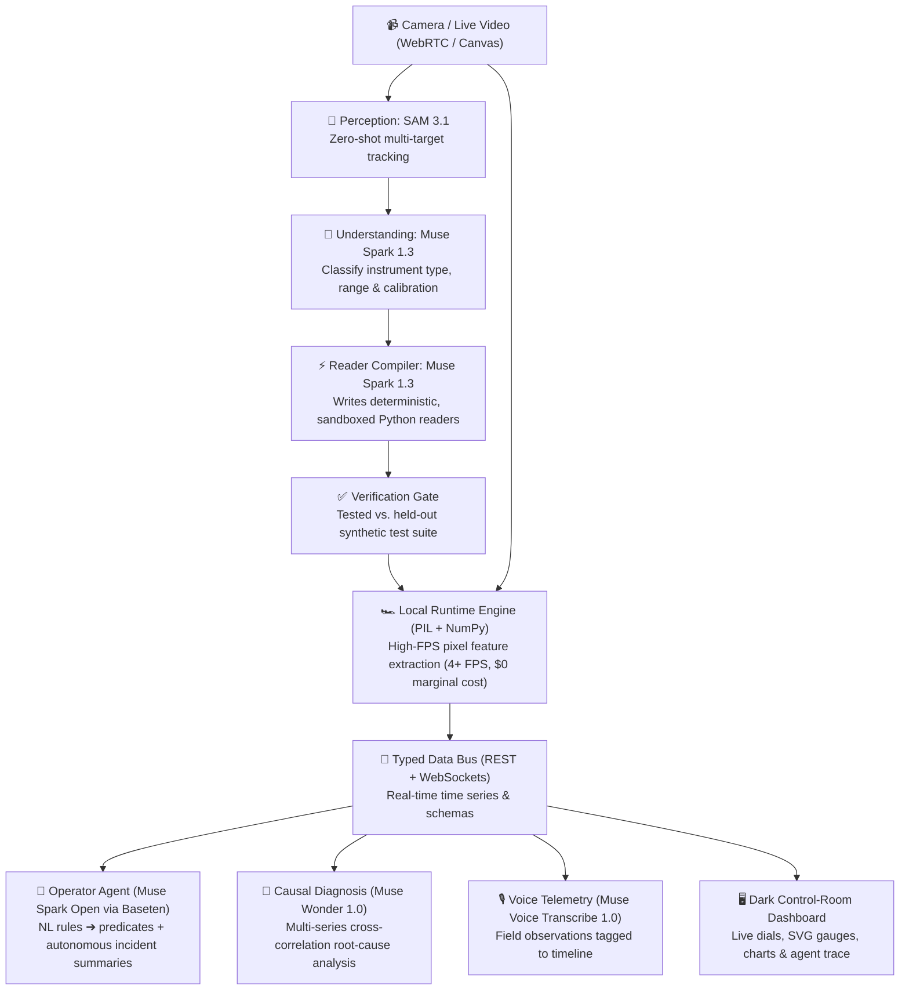

<div align="center">

# ⚡ Retrofit

### Legacy Industrial Control Panels as Live, Typed, Queryable Data Streams

[](https://www.python.org/)
[](https://fastapi.tiangolo.com/)
[](https://dev.meta.ai/)
[](https://www.baseten.co/)
[](tests/)
[](LICENSE)

**Meta Global AI Developer Hackathon Submission**  
**Track:** *Push the Frontier* (Software, Manufacturing, Energy, Physical Systems)  
**Target Bonuses:** *Best Build on Meta Open-Weight Models* ($10K) · *Best Agentic Use-Case* ($5K)

</div>

---

## 🏭 The Industrial Problem

Across manufacturing plants, water utilities, refineries, and power grids, **billions of dollars of critical infrastructure runs on legacy analog equipment** — needle pressure gauges, bimetallic thermometers, 7-segment digital readouts, and indicator lamps. 

Digitizing this equipment traditionally requires:
- ❌ Shutting down active production lines.
- ❌ Cutting pipes to plumb electronic pressure transducers.
- ❌ Pulling miles of industrial cabling and upgrading PLCs.
- ❌ Spending **\$10,000 – \$50,000+** per panel retrofit.

**Retrofit solves this with zero hardware downtime.** Point any standard webcam or smartphone camera at an analog panel, and Retrofit transforms every gauge and lamp into a live, typed, queryable WebSocket & REST telemetry feed.

---

## 💡 The Architectural Breakthrough: "Compile the Model Out of the Loop"

The naive AI approach — sending 30 video frames per second to a cloud Vision-Language Model (VLM) — is economically unviable and technically flawed (massive latency, enormous token bills, unreliable hallucinations).

**Retrofit flips this paradigm:**



1. **Frontier models run ONCE at initialization:**
   - **SAM 3.1** detects and tracks all instrument bboxes in a single pass.
   - **Muse Spark** classifies the instruments and **writes deterministic Python code** (`def read(features): ...`) for each dial.
   - The code is verified against a held-out test suite with exact ground truth before compiling.
2. **Local runtime runs at native camera frame rates:**
   - Real computer vision ([`backend/vision.py`](backend/vision.py)) extracts physical features (radial ray casting for needle angles, normalized luminance for indicator lights).
   - The compiled readers execute locally with **zero per-frame model calls** and **zero token costs**.

---

## 🤖 Meta Models in Action

Every Meta model in Retrofit performs a dedicated, load-bearing role with transparent model-source disclosure:

| Model | Deployment | Core Responsibility in Retrofit |
|---|---|---|
| **SAM 3.1** | Meta Model API (`/v1/responses`) | **Multi-Object Perception:** Zero-shot multi-instrument segmentation and bounding box tracking. |
| **Muse Spark 1.3** | Meta Model API (`/v1/chat/completions`) | **Understanding & Compiler:** Identifies dial calibrations and generates verified Python readers. |
| **Muse Spark Open** (`muse-spark-open-1026`) | **Baseten** Serverless Inference | **Edge Operator Agent:** Compiles NL rules to predicates; acts as an autonomous incident responder on threshold breach. |
| **Muse Wonder 1.0** | Meta Model API (`/v1/chat/completions`) | **Causal Root-Cause Reasoning:** Synthesizes multi-instrument time series, rate-of-change statistics, and operator notes to answer *"Why did X happen?"*. |
| **Muse Voice Transcribe 1.0** | Meta Model API (`/v1/asr/transcribe`) | **Voice Telemetry:** Ingests field operator voice memos (16 kHz mono WAV) directly onto the live event timeline. |

> [!NOTE]
> **Graceful Fallbacks by Design:** Every layer includes a documented, transparent fallback ([`docs/FALLBACKS.md`](docs/FALLBACKS.md)). If an external endpoint experiences latency or downtime, the system degrades gracefully without breaking the demo or crashing the runtime.

---

## 🔬 Physical Reality Computer Vision (`backend/vision.py`)

Retrofit is not a mockup or simulation shell — it runs an actual, real-time image processing engine:

- 🔦 **Indicator Lamps (`brightness`):** Extracts the target bounding box, converts to grayscale, and computes normalized luminance:
  $$\text{Luminance} = \frac{1}{255 \cdot N} \sum_{i=1}^N g_i$$
  *Instant physical test: Shine a phone flashlight at the webcam, and the dashboard indicator flips ON/OFF in real time.*
- ⏱️ **Analog Gauges (`needle_angle`):** Computes dial center $(c_x, c_y)$ and casts 600 radial scanlines in $0.5^\circ$ increments over the dial sweep. The dominant dark pixel ray overlap determines the physical needle angle ($\pm 5^\circ$ verified accuracy).
- 🔢 **Digital Displays (`digits_value`):** Isolates illuminated cells via bright-pixel projection and classifies 7-segment digit bitmasks.

---

## 🚀 Quickstart

### Prerequisites
- Python 3.12+ (or Homebrew Python 3.13/3.15)
- Meta Model API Key ([dev.meta.ai](https://dev.meta.ai))
- (Optional) Baseten API Key for Muse Spark Open

### Installation

```bash
# Clone the repository
git clone https://github.com/nur-srijan/retrofit.git
cd retrofit

# Set up environment
python3 -m venv .venv
source .venv/bin/activate
pip install -r requirements.txt

# Configure your API keys
cp .env.example .env
# Edit .env with your MODEL_API_KEY and BASETEN_API_KEY
```

### Run the Server

```bash
# Start the FastAPI + WebSocket backend
uvicorn backend.app:app --host 0.0.0.0 --port 8000
```

Open **`http://localhost:8000`** in your browser.

---

## 🎮 How to Demo

1. **Option A: Physical Camera Demo**
   - Click **Start camera** (grants webcam access).
   - Click **Autopilot** $\to$ SAM 3.1 and Muse Spark detect the panel, compile verified readers, and launch monitoring.
   - Shine a phone flashlight into the bottom-right corner $\to$ watch the **Indicator Light** snap `ON` live.
2. **Option B: One-Click Simulated Demo Rig**
   - Click **Start demo panel** $\to$ streams live synthetic pressure, temperature, timer, and lamp signals through the exact same compiled readers, charts, and agent rules.
3. **Agent Interactions:**
   - **Rules:** Enter `"alert when pressure goes above 80"` $\to$ Muse Spark Open compiles the rule; on alert, it automatically issues an incident summary.
   - **Voice:** Click **Record**, speak an observation, and click **Stop & Transcribe**.
   - **Root-Cause Reasoning:** Ask *"Why did pressure drop?"* $\to$ Muse Wonder inspects the active time series and returns a grounded diagnostic report citing exact numerical evidence.

---

## 🧪 Testing & Verification

The codebase includes comprehensive unit and live end-to-end integration tests:

```bash
# Run the full 27-test unit suite (reader compiler, CV vision, SAM parser, agent rules)
PYTHONPATH=. pytest tests/ -v

# Run live end-to-end verification against real Meta API endpoints
python3 scripts/e2e_check.py
```

```text
============================== test session starts ==============================
tests/test_agent.py ........                                             [ 26%]
tests/test_features.py ...                                               [ 36%]
tests/test_readers.py ...                                                [ 46%]
tests/test_sam_parser.py .........                                       [ 76%]
tests/test_vision.py .......                                             [100%]
============================== 30 passed in 0.42s ==============================
```

---

## 📜 Contract-First Architecture

All subsystems communicate strictly via validated JSON contracts in [`contracts/`](contracts/):
- [`contracts/instrument.json`](contracts/instrument.json) — Normalized instrument specification & calibration curves.
- [`contracts/reading.json`](contracts/reading.json) — Streaming telemetry packet schema.
- [`contracts/compiled_reader.json`](contracts/compiled_reader.json) — Sandboxed executable reader code & verification metrics.
- [`contracts/rule.json`](contracts/rule.json) — Compiled predicate alert rules.
- [`contracts/events.json`](contracts/events.json) — Voice notes, incident summaries, and alert events.
- [`contracts/why.json`](contracts/why.json) — Structured causal explanation with cited numerical evidence.

---

## 🏆 Built During the Hackathon

In strict adherence to the hackathon guidelines:
- **100% Original Code:** All code in this repository was conceived and written during the Meta Global AI Developer Hackathon building period (Oct 27 – Nov 4, 2026).
- **Public Open-Source:** Fully accessible repository with MIT license.
- **Auditable Design:** Full architectural blueprints and fallback disclosures documented under [`docs/`](docs/).
