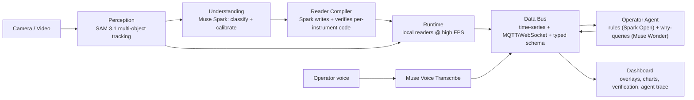

# Retrofit — Architecture (High Level)

> Point a camera at any legacy control panel → get a live, typed, queryable API for every instrument on it.

## One-line flow
**Camera → Perceive → Understand → Compile → Stream → Reason → Act/Show**

## Layers

| # | Layer | Responsibility | Meta model |
|---|---|---|---|
| 1 | Perception | Find + track every instrument (gauges, 7-seg, lights, switches) in one pass | SAM 3.1 |
| 2 | Understanding | Identify instrument type, units, range, calibration map | Muse Spark |
| 3 | Reader Compiler | Generate a deterministic reader per instrument, verify vs. model readings on held-out frames, retry until under error threshold | Muse Spark |
| 4 | Runtime | Run compiled readers locally on live frames — no per-frame model calls | — |
| 5 | Data Bus | Store time-series, expose typed schema + live stream (MQTT/WebSocket) | — |
| 6 | Operator Agent | NL rules → compiled predicates; voice log events; "why did X happen?" over all series | Muse Spark Open (Baseten), Muse Wonder, Muse Voice Transcribe |
| 7 | Dashboard | Live video with overlays, charts, verification report, agent reasoning trace | — |

## Key design principles
1. **Model compiles itself out of the loop** — expensive models run once per instrument at setup; runtime is cheap and deterministic.
2. **Verifiable by construction** — every compiled reader ships with an accuracy report shown in the UI.
3. **Contract-first modules** — layers talk only via JSON contracts so they can be built in parallel and swapped/mocked.
4. **Graceful fallback** — if video tracking or compilation fails, fall back to per-frame SAM/Spark at low FPS; demo must never break.
5. **Visible complexity** — every capability must appear in the 3-minute demo.

## Demo rig
Bike-pump pressure gauge, kitchen thermometer, phone stopwatch (7-segment), lamp (indicator light) — all in one frame.

